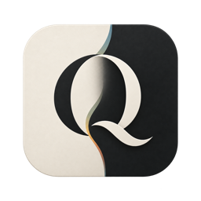

```asciidoc
// @(#)quiet / asciidoc / README.adoc / 2026-10-26



= quiet

A restrained semantic color system for long-duration work.

_The interface should become scenery._

Color is allowed to organize.  It is not allowed to shout.

quiet derives application palettes from semantic roles and explicit
constraints rather than hand-picked theme values.

image::docs/assets/header/quiet-header.png[quiet-day and quiet-night in Terminal.app with Vim and Xcode,align=center]

== What it is

quiet is a semantic color system for software used for hours at a time.

Ten semantic anchors. +
Two adaptations. +
Deterministic derivation. +
Forty-seven current quiet-core constraints.

Not a theme pack. +
Not a skin. +
Not a pile of hex values.

quiet ports color systems.

It does not redesign the applications that use them.

== The system

The ten semantic anchors are:

----
Field      Surface      Structure
Ink        Muted        Line

Mineral    Moss         Ochre        Rust
----

They describe roles rather than application-specific colors.

Applications map their own interface elements onto those roles.

The canonical palettes live in:

----
spec/quiet-day.json
spec/quiet-night.json
----

== Day / Night

quiet-day and quiet-night are adaptations of the same semantic system.

They preserve the same roles and relationships under different viewing
conditions.

They are not mathematical inversions.

== Use it

[cols="^1,^1,^1",options="noheader"]
|===
| link:ports/web/[CSS / Web]
| link:ports/machine/[Machine JSON]
| link:ports/terminal/[ANSI]

| link:ports/base16/[Base16]
| link:ports/base24/[Base24]
| link:ports/terminal/terminal-app/[Terminal.app]
|===

Base16 and Base24 are compatibility projections.

The native exports preserve quiet's own semantic vocabulary.

== Ports

[cols="^1,^1,^1,^1",options="noheader"]
|===
| link:ports/terminal/terminal-app/[Terminal.app]
| link:ports/x11/[X11]
| link:ports/dircolors/[GNU dircolors]
| link:ports/ghostty/[Ghostty]

| link:ports/iterm2/[iTerm2]
| link:ports/kitty/[kitty]
| link:ports/wezterm/[WezTerm]
| link:ports/emacs/[Emacs]

| link:ports/vim/[Vim]
| link:ports/neovim/[Neovim]
| link:ports/helix/[Helix]
| link:ports/vscode/[VS Code]

| link:ports/zed/[Zed]
| link:ports/jetbrains/[JetBrains]
| link:ports/xcode/[Xcode]
| link:ports/firefox/[Firefox]

| link:ports/chrome/[Chrome]
| link:ports/tmux/[tmux]
| link:ports/fzf/[fzf]
| link:ports/delta/[delta]

| link:ports/tmtheme/[bat]
| link:ports/tmtheme/[Sublime Text]
|
|
|===

== Underneath

quiet is specified rather than eyeballed.

sRGB · OKLab / OKLCH · deterministic derivation · WCAG contrast ·
gamut validation · CVD screening · human review

Current quiet-core validation:

----
quiet-day:   PASS (47/47)
quiet-night: PASS (47/47)
----

The specification defines the relationships.

The palettes are outputs of those relationships.

The ports adapt those outputs to applications.

== Build

----
make check
make build
make generate
----

The reference implementation can inspect, derive, validate, and export quiet:

----
./bin/quiet inspect '#4A6E7A'

./bin/quiet derive spec/quiet-day.json

./bin/quiet check \
    spec/quiet-core.json \
    spec/quiet-day.json \
    spec/quiet-night.json
----

== Read more

[cols="^1,^1,^1,^1",options="noheader"]
|===
| link:spec/quiet-core.adoc[Specification]
| link:PORTING.adoc[Porting]
| link:docs/versioning.adoc[Versioning]
| link:CONTRIBUTING.adoc[Contributing]
|===

Design evidence lives in `reports/`: quiet-core conformance, the Wash
derivation, and color-vision deficiency screening.

The reference interface lives in `examples/reference-interface/`.

== Status

quiet-core and the canonical palettes are stable.

Changes follow quiet's link:docs/versioning.adoc[versioning policy].

MIT.  See `LICENSE`.

'''

_The interface should become scenery._
```
