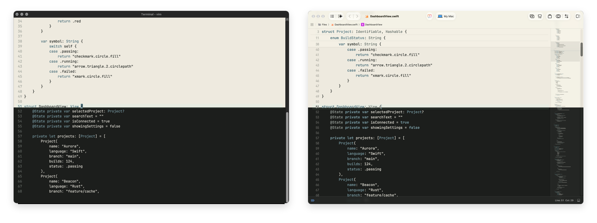

// @(#)quiet / asciidoc / README.adoc / 2026-10-19

----
  ___       _     _
 / _ \ _  _(_)___| |_
| (_) | || | / -_)  _|
 \__\_\\_,_|_\___|\__|.
----

A restrained color system for long-duration work.

_The interface should become scenery._

Color is allowed to organize.  It is not allowed to shout.

== Why

Quiet is a semantic color system for software used for hours at a time.

Not a theme pack. +
Not a skin. +
Not a pile of hex values.

Ten semantic anchors. +
Two adaptations. +
Deterministic derivation. +
Nineteen current Core constraints.

Quiet ports color systems.

It does not redesign the applications that use them.

== Day / Night

Quiet Day and Quiet Night are adaptations of the same semantic system.

They are not mathematical inversions.

----
Field      Surface      Structure
Ink        Muted        Line

Mineral    Moss         Ochre        Rust
----

The canonical palettes live in:

----
spec/quiet-day.json
spec/quiet-night.json
----

== Use it

[cols="^1,^1,^1",options="noheader"]
|===
| link:ports/web/[CSS / Web]
| link:ports/machine/[Machine JSON]
| link:ports/terminal/[ANSI]

| link:ports/base16/[Base16]
| link:ports/base24/[Base24]
| link:ports/terminal/terminal-app/[Terminal.app]
|===

Base16 and Base24 are compatibility projections.

The native exports preserve Quiet's own semantic vocabulary.

== Ports

[cols="^1,^1,^1,^1",options="noheader"]
|===
| link:ports/terminal/terminal-app/[Terminal.app]
| link:ports/x11/[X11]
| CDE
| link:ports/dircolors/[GNU dircolors]

| SGI 4Dwm
| link:ports/ghostty/[Ghostty]
| link:ports/iterm2/[iTerm2]
| link:ports/kitty/[kitty]

| Alacritty
| link:ports/wezterm/[WezTerm]
| Windows Terminal
| link:ports/emacs/[Emacs]

| link:ports/vim/[Vim]
| link:ports/neovim/[Neovim]
| link:ports/vscode/[VS Code]
| JetBrains

| link:ports/xcode/[Xcode]
| Firefox
| Chrome
| Slack

| link:ports/tmux/[tmux]
| Zellij
| fzf
| bat

| delta
|
|
|
|===

Available ports are linked.

The rest are on the road ahead.

== Underneath

Quiet is specified rather than eyeballed.

sRGB · OKLab / OKLCH · deterministic derivation · WCAG contrast ·
gamut validation · CVD screening · human review

Current Core validation:

----
Quiet Day:   PASS (19/19)
Quiet Night: PASS (19/19)
----

== Build

----
make check
make build
make generate
----

The reference implementation can inspect, derive, validate, and export Quiet:

----
./bin/quiet inspect '#4A6E7A'

./bin/quiet derive spec/quiet-day.json

./bin/quiet check \
    spec/quiet-core.json \
    spec/quiet-day.json \
    spec/quiet-night.json
----

== Read more

[cols="^1,^1,^1",options="noheader"]
|===
| link:spec/quiet-core.adoc[Specification]
| link:PORTING.adoc[Porting]
| link:CONTRIBUTING.adoc[Contributing]
|===

Design evidence lives in `reports/`.

The reference interface lives in `examples/reference-interface/`.

== Status

Quiet Core 0.1 is under development.

Day and Night remain candidate data while reference-port work and broader
testing continue.

MIT.  See `LICENSE`.

'''

_The interface should become scenery._

